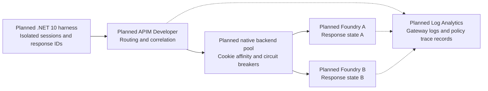

# 🧭 APIM Responses API affinity lab

**One conversation. One backend. Evidence for every turn.**

A planned hands-on lab exploring conversation-aware routing through Azure API
Management to two Microsoft Foundry backends. It will show why a
`previous_response_id` chain needs routing continuity, how independent requests
are distributed, and what happens when a conversation's backend becomes
unavailable.

> **Design investigation, not the self-service lab.** Bootstrap is merged.
> Task `001` completed an explicitly authorized
> [disposable feasibility experiment](experiments/001-affinity/README.md):
> healthy affinity, native pinned failure, concrete-member identity, recovery,
> and workspace policy traces were verified. The temporary group is deleted.
> The complete Bicep,
> `azd` workflow, and .NET harness remain tasks `002`-`008`.

## 🗺️ The planned journey

*Conceptual architecture only.* Solid arrows show requests; dotted arrows show
the proposed diagnostics flow. The harness keeps routing context, Foundry owns
response state, and APIM is not a conversation-history database. Native pinning
during the tested breaker-open window was verified in the disposable experiment;
the complete self-service workflow is still planned.

## 🔎 What we know so far

| Area | Current finding |
| --- | --- |
| Region and gateway | West US 3, Developer SKU, one unit; disposable deployment verified and deleted |
| Model | **GPT-5.4 mini**, version `2026-03-17`, `GlobalStandard`; both temporary backends served Responses |
| Healthy-session routing | Four independent three-turn chains stayed pinned; eight stateless calls observed A=4/B=4 |
| Failure semantics | Existing A cookie received **503 / `CircuitBreakerIsOpen` without forwarding**, while three fresh sessions reached B; the original chain recovered on A |
| Backend proof | Outbound effective request host identified A/B and matched debug/workspace evidence; `context.Backend.Id` reported the pool, not the member |
| Tracing | All 54 captured responses joined to workspace rows with actual policy `TraceRecords`; full debugger transcripts remained separate |

Details, exact versions, sources, verification date, budgets, and limitations
are in the [platform evidence and design contract](docs/DESIGN.md). These
findings include live feasibility evidence, not completion of the full lab.
See the [sanitized run evidence](evidence/samples/task001-feasibility.json).
The 30-second breaker can expire while a fault persists; healthy-only new
routing is demonstrated within its open window, not promised indefinitely.

Both Foundry resources are planned for **West US 3**. The selected
`GlobalStandard` model deployment can process inference globally; resource
location does not imply West US 3-only processing.

## 🧪 Scenarios we intend to prove

| Scenario | Success means |
| --- | --- |
| Stateful conversations | Each independent response-ID chain stays on its original backend |
| Stateless distribution | Independent calls observe both backends; no promised perfect split |
| Controlled failure | The pinned conversation fails explicitly while fresh sessions reach a healthy backend |
| Recovery and evidence | The backend is restored, recovery is observed, and gateway/policy records correlate with the run |

The implementation will use Bicep and APIM policy XML, a .NET 10 console
harness, `azd` orchestration, an equivalent Azure CLI path, and Log Analytics.
The experiment has its own guarded probe, not the planned full-lab deployment
workflow or .NET harness.

## 📚 Follow the work

| Document | Purpose |
| --- | --- |
| [Lab plan](docs/PLAN.md) | Agreed requirements and mandatory design gates |
| [Design and evidence](docs/DESIGN.md) | Verified findings, selected contracts, and resolved gates B1-B2 |
| [Task backlog](docs/TASKS.md) | Ordered work and acceptance criteria |
| [Progress tracker](docs/PROGRESS.md) | Authorization, execution history, and PR state |
| [Contributor instructions](.github/copilot-instructions.md) | Branch workflow, checks, and README standards |

## 🤝 Contributing safely

Use a focused work branch, not `main`. Keep the task and progress records
current, perform relevant checks, and open a PR when branch work is complete.
Leave PRs unmerged for the user. Start dependent work only from a merged
dependency or an explicitly documented dependency branch.

For documentation/bootstrap changes, run `git diff --check`, verify relative
links and relevant ignore behavior, and inspect the diff for scope and secrets.
Build/test commands and solution CI will be added when actual projects exist.
Text formatting is defined by `.editorconfig` and `.gitattributes`.

Never commit credentials or private environment settings. `.env.example` and
`.env.sample` files may contain placeholders only. Generated output belongs in
ignored `artifacts/` or `evidence/`; intentionally sanitized examples may be
versioned under `evidence/samples/`. Azure/azd local state is not versioned.

Current task `001` has explicit authorization for the temporary billable
deployment, reversible fault, evidence, and cleanup in its dedicated group.
This does not authorize tasks `002`-`008` or operations against other resources.
The experiment used 59 of its 64-request allowance and deleted the dedicated
group within the three-hour bound. Both deleted Foundry accounts were purged
and model quota returned to baseline. Azure retains normal APIM/workspace
soft-delete recovery records; they are not a running gateway or workspace.
The under-$5 target was an estimate, not a billing cap; the final Azure bill
is not yet available. Later deployments still require explicit authorization.
