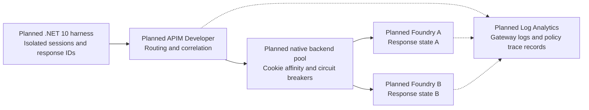

# 🧭 APIM Responses API affinity lab

**One conversation. One backend. Evidence for every turn.**

A planned hands-on lab exploring conversation-aware routing through Azure API
Management to two Microsoft Foundry backends. It will show why a
`previous_response_id` chain needs routing continuity, how independent requests
are distributed, and what happens when a conversation's backend becomes
unavailable.

> **Design investigation, not a runnable lab.** Bootstrap is merged. Task `001`
> has documentation and read-only Azure evidence, but remains **blocked** on
> the native pinned-failure/member-identity contract and the trace requirement.
> There are no deployment scripts, Bicep resources, APIM policies, or .NET
> projects yet. No Azure resources have been created by this work.

## 🗺️ The planned journey

*Conceptual architecture only.* Solid arrows show requests; dotted arrows show
the proposed diagnostics flow. The harness keeps routing context, Foundry owns
response state, and APIM is not a conversation-history database. Native pinning
during failure is a design gate, not a verified capability of this lab.

## 🔎 What we know so far

| Area | Current finding |
| --- | --- |
| Region and gateway | West US 3, Developer SKU; documented feature support, not a deployed gateway |
| Model candidate | **GPT-5.4 mini**, version `2026-03-17`, `GlobalStandard`; read-only catalog/quota/capacity checks passed |
| Healthy-session routing | Native cookie affinity is documented; per-session cookie isolation is the proposed harness contract |
| Failure semantics | Existing cookie plus tripped breaker still needs authoritative confirmation or an explicitly authorized feasibility test |
| Backend proof | Same-region labels cannot distinguish A/B; concrete gateway-derived identity must be verified |
| Tracing | Policy trace records have a documented workspace destination; full debugger transcripts are separate |

Details, exact versions, sources, verification date, budgets, and limitations
are in the [platform evidence and design contract](docs/DESIGN.md). These
findings do not establish live inference, runtime affinity, or diagnostic
ingestion.

Both Foundry resources are planned for **West US 3**. The selected
`GlobalStandard` model deployment can process inference globally; resource
location does not imply West US 3-only processing.

## 🧪 Scenarios we intend to prove

| Scenario | Success means |
| --- | --- |
| Stateful conversations | Each independent response-ID chain stays on its original backend |
| Stateless distribution | Independent calls observe both backends; no promised perfect split |
| Controlled failure | The pinned conversation fails explicitly while fresh sessions reach a healthy backend |
| Recovery and evidence | The backend is restored, recovery is observed, and gateway/policy records correlate with the run |

The implementation will use Bicep and APIM policy XML, a .NET 10 console
harness, `azd` orchestration, an equivalent Azure CLI path, and Log Analytics.
No run or deployment commands are published yet because they do not exist.

## 📚 Follow the work

| Document | Purpose |
| --- | --- |
| [Lab plan](docs/PLAN.md) | Agreed requirements and mandatory design gates |
| [Design and evidence](docs/DESIGN.md) | Verified findings, proposed contracts, and blockers B1-B3 |
| [Task backlog](docs/TASKS.md) | Ordered work and acceptance criteria |
| [Progress tracker](docs/PROGRESS.md) | Authorization, execution history, and PR state |
| [Contributor instructions](.github/copilot-instructions.md) | Branch workflow, checks, and README standards |

## 🤝 Contributing safely

Use a focused work branch, not `main`. Keep the task and progress records
current, perform relevant checks, and open a PR when branch work is complete.
Leave PRs unmerged for the user. Start dependent work only from a merged
dependency or an explicitly documented dependency branch.

For documentation/bootstrap changes, run `git diff --check`, verify relative
links and relevant ignore behavior, and inspect the diff for scope and secrets.
Build/test commands and solution CI will be added when actual projects exist.
Text formatting is defined by `.editorconfig` and `.gitattributes`.

Never commit credentials or private environment settings. `.env.example` and
`.env.sample` files may contain placeholders only. Generated output belongs in
ignored `artifacts/` or `evidence/`; intentionally sanitized examples may be
versioned under `evidence/samples/`. Azure/azd local state is not versioned.

Current task `001` authorization covers design and read-only checks only.
Writing code does not authorize Azure deployment, resource changes, controlled
faults, or teardown. Obtain explicit authorization for those operations.
Developer APIM, model use, and log ingestion can incur charges; no price ceiling
or automatic resource cleanup is promised.
