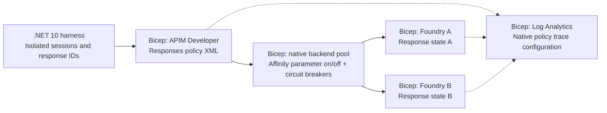
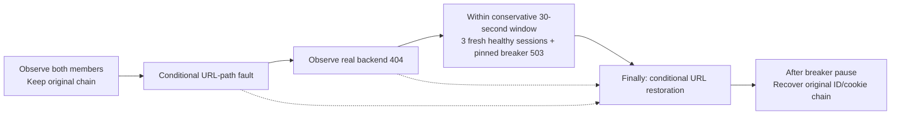

# 🧭 APIM Responses API affinity lab

**One conversation. One backend. Evidence for every turn.**

A hands-on lab demonstrating conversation-aware routing through Azure API
Management to two Microsoft Foundry backends. It shows why a
`previous_response_id` chain needs routing continuity, how independent requests
are distributed, and what happens when a conversation's backend becomes
unavailable.

> **Start with the [step-by-step walkthrough](docs/WALKTHROUGH.md).**
> Choose azd or Azure CLI, deploy the same Bicep, and compare affinity **off**
> versus **on** using real response-ID chains. Native affinity is **on by
> default**; the off-mode demo is explicit and never fabricates a failure.
> Both original deployment paths, pinned failure/recovery, trace correlation,
> reruns, and scoped cleanup were live-verified in merged PR #9.
> Task `008` live-proved the toggle: four real cross-backend failures with
> affinity off, then 24 successful requests with affinity on. Its
> [sanitized results](evidence/samples/task008-verification.json) and
> [actual console examples](evidence/samples/task008-console.md) preserve
> outcomes and trace proof. The unchanged rerun preserved all 13 runtime
> values; the disposable lab is verified deleted without purge.

## 🚀 Start here

Use **PowerShell 7**, Git, Azure CLI **2.83.0+** with Bicep, and the **.NET 10
SDK**. Add azd **1.36.0+** only for the azd driver. You need an enabled AzureCloud
subscription, registered providers, model quota, and permission to create/delete
the dedicated group, deploy its resources, assign the two narrow roles, read
the API-scoped gateway key, and query its workspace.

The [walkthrough](docs/WALKTHROUGH.md) covers sign-in, exact target checks,
publisher configuration, **both complete deployment paths**, publishing/running
the client, affinity comparison, diagnostic queries, troubleshooting, and
verified teardown. Commands run from the repository root; no global
subscription switch, hidden sign-in, or existing-resource adoption occurs.

The switch is a native Bicep parameter, not a client-side pinning trick:

```bicep
param sessionAffinityEnabled bool = true // false omits native pool sessionAffinity
```

For either guarded deployment driver, set the process configuration:

```powershell
$env:LAB_SESSION_AFFINITY_ENABLED = 'false' # unpinned comparison
# Set 'true' for normal operation. Changing an existing lab also requires
# Provision -AllowDeploy -AllowAffinityChange; every other input stays fixed.
```

With affinity **off**, independent pool choices can send a valid
`previous_response_id` to the other account, which does not own that response.
A same-backend continuation can still succeed: the demo only passes when it
observes an actual correlated cross-backend response-state lookup failure,
including the service's verified different-resource error.
With affinity **on**, the client returns each session's native cookie and
requires every completed turn to stay on that session's original member.
See [how the setting, cookie, and response chain connect in code](#-how-affinity-and-response-chaining-connect).

## 🗺️ Architecture in code



*Implemented components; task `007` verified both deployment lifecycles on
October 15-16, 2026. Task `008` additionally verified native affinity off/on.*
Solid arrows show requests; dotted arrows show diagnostics. The harness keeps
routing context, Foundry owns response state, and APIM is not a
conversation-history database. Native pinning
during the tested breaker-open window was verified in the disposable experiment;
the off/on walkthrough is tracked separately from that earlier proof.

## 🔎 What we know so far

| Area | Current finding |
| --- | --- |
| Region and gateway | West US 3, Developer SKU, one unit; clean azd and CLI deployments verified |
| Identity and model | Dedicated user-assigned identity, two resource-scoped grants; **GPT-5.4 mini** / `2026-03-17` / `GlobalStandard` |
| Healthy-session routing | In each environment, four independent three-turn chains stayed pinned; 12 stateless calls observed A=6/B=6 |
| Failure semantics | Existing A cookie received **503 / `CircuitBreakerIsOpen` without forwarding**, while three fresh sessions reached B; the original chain recovered on A |
| Backend proof | Outbound effective request host identified A/B and matched workspace backend URLs and policy traces; model text is not routing evidence |
| Tracing | Task `007`: 64/64 requests joined to actual policy `TraceRecords`; task `008`: another 42/42 joined, including off-mode failures |
| Lifecycle | Task `007` reruns preserved all 12 original runtime values; both owned groups are absent with recovery records retained. Task `008` rerun preserved all 13 current values |
| Native affinity switch | Off: four A-to-B chains broke with the exact different-resource error. On: four three-turn chains stayed pinned, and 12 stateless calls reached both members |

Details, exact versions, sources, verification date, budgets, and limitations
are in the [platform evidence and design contract](docs/DESIGN.md). These
findings distinguish the earlier disposable feasibility experiment from
[task `007` baseline evidence](evidence/samples/task007-verification.json) and
the [task `008` affinity comparison](evidence/samples/task008-verification.json).
The [task `001` sample](evidence/samples/task001-feasibility.json) remains historical.
The 30-second breaker can expire while a fault persists; healthy-only new
routing is demonstrated within its open window, not promised indefinitely.

Both Foundry resources are configured for **West US 3**. The selected
`GlobalStandard` model deployment can process inference globally; resource
location does not imply West US 3-only processing.

## 🧪 Verified scenarios

| Scenario | Success means |
| --- | --- |
| Stateful conversations | Each independent response-ID chain stays on its original backend |
| Affinity off | A valid chained response ID reaches the other backend and receives its actual missing-response error; no switch means inconclusive |
| Stateless distribution | Independent calls observe both backends; no promised perfect split |
| Controlled failure | The pinned conversation fails explicitly while fresh sessions reach a healthy backend |
| Recovery and evidence | The backend is restored, recovery is observed, and gateway/policy records correlate with the run |

The lab now has Bicep and APIM policy XML, `azd` orchestration, an equivalent
Azure CLI path, Log Analytics configuration, and the .NET 10 console harness.
Task `006` implements the opt-in fault workflow; both environments passed
healthy and failure/recovery verification in task `007`.
The experiment has its own guarded probe, separate from the full-lab lifecycle
and .NET client.

## 🧱 Infrastructure and gateway configuration

[`infra/main.bicep`](infra/main.bicep) is resource-group-scoped: one Developer
gateway, two identical Foundry model deployments, scoped managed-identity
permissions, and Log Analytics. The gateway uses one dedicated **user-assigned
managed identity**, explicitly selected by the backend authentication policy;
no system-assigned fallback. It enables every inventoried parent log category
and `AllMetrics`, including workspace diagnostics. The group remains
externally owned; the template neither creates it nor selects a subscription.

Both lifecycle drivers use native [`deploy.bicepparam`](infra/deploy.bicepparam)
inputs; [`main.bicepparam`](infra/main.bicepparam) remains a placeholder-only
lower-level example. Local settings and compiler artifacts are ignored.
Exact AVM pins, parameter/output contracts,
diagnostic exclusions, and the local build/test commands are in the
[infrastructure reference](infra/README.md).

Task `003` adds a single HTTPS `POST /openai/v1/responses` operation, two
TLS-validated backends, the native affinity pool/breakers, API-scoped
subscription access, and managed-identity authentication. The
[gateway contract](infra/policies/README.md) explains first/chained/stateless
requests, lab-only headers, explicit errors, and trustworthy backend evidence.

The gateway returns `X-Lab-Request-Id` and a host-verified
`X-Lab-Backend-Id` after forwarding. Native policy traces are configured for
Log Analytics with zero body capture and no credential/cookie header capture.
The policy never retries a broken chain onto another backend.

In both task `007` samples and the task `008` comparison, APIM captured no bodies, credential/cookie headers,
or client IP. Workspace/table retention was 30 days except `Usage` at 90 days.
Query audits can contain operator/query metadata. Azure Policy also configured
central Foundry logging: that external destination was neither queried nor
modified, and its privacy/retention is not controlled by this lab.

**Evidence boundary:** local Bicep, XML, compiled-expression, and contract
checks do not establish live behavior. Task `007` separately records actual
provisioning through both drivers, routing, and ingestion; task `008` records
the additional off/on proof and its actual service-error contract. No new Azure operations were performed
for tasks `002`-`006`; running the lifecycle scripts or inference still requires separate
target/action authorization.

## 🚦 Guarded deployment lifecycle

Task `004` implements two paths over the **same Bicep and native parameters**:
`Azd` uses `azd provision`; `Cli` uses Azure CLI only. Both check the active
subscription, exact model/quota/capacity, permissions, and group ownership,
create the dedicated group outside Bicep, and perform Provider validation and
what-if before deployment. Neither silently changes subscription or region.

| Action | Explicit opt-in / boundary |
| --- | --- |
| `Preflight` / `Export` | `-AllowAzure`, including read-only subscription checks |
| `Provision` | `-AllowAzure -AllowDeploy`; new or provably owned dedicated group only |
| `Run` | `-AllowAzure -AllowCredentialRead`, plus client `--allow-requests`; key in process environment only |
| Failure `Run` | Additionally `-AllowFaults -ConfirmResourceGroup <exact-name>` and the client's exact failure opt-ins; owned backend URL-only conditional updates |
| `Down` | `-AllowAzure -AllowDelete -ConfirmResourceGroup <exact-name>`; inventory-checked group deletion, no permanent purge |

Use **PowerShell 7**, Azure CLI 2.83.0+ with Bicep, and azd 1.36.0+ for the
`Azd` path. The [lifecycle guide](scripts/README.md) covers local publisher
configuration, both command paths, guarded environment records, non-secret
client handoff, affinity-only updates, reruns, failure handling, and scoped teardown.
Use its wrapper rather than bare `azd` commands.

Task `007` verified both drivers' provisioning, process-only key handoff,
healthy/fault scenarios, diagnostic ingestion, unchanged rerun, and scoped
group deletion. Initial deployment polling errors required explicit
authentication/state reconciliation; they are recorded rather than hidden.
No result is inferred from the offline tests.

## 💬 Conversation harness

Task `005` adds a .NET 10 console app with no model SDK or agent framework.
It interleaves independent multi-turn sessions, separately runs stateless
calls, and emits each turn's prompt/assistant text, response-chain IDs, actual
gateway request UUID, concrete member, safe cookie fingerprint, and outcome.
The final session table and separate distributions include failed and
unattempted work; a missing member is a failed observation, not a promised 50/50.

```powershell
# No Azure sign-in or inference: build, tests, and formatting checks.
dotnet build .\ResponsesLab.slnx --configuration Release
dotnet test .\ResponsesLab.slnx --configuration Release --no-restore
dotnet format .\ResponsesLab.slnx --verify-no-changes --no-restore
```

Defaults cap the script at 24 requests, 2,048 output tokens per request,
one request at a time, ten-second spacing, and a ten-minute overall deadline.
The client stops a broken chain; it never retries, restarts history, or accepts
a changed/missing member. The [harness guide](src/ResponsesLab/README.md)
documents publishing, the exact guarded run command, configuration bounds,
evidence fields, privacy, and exit codes. Offline checks do not replace the
separately recorded live evidence. Generated explanations can be inaccurate;
only gateway-derived member evidence and correlated records establish routing.

## 🔗 How affinity and response chaining connect

**The gateway creates the pin; the harness carries it forward; Foundry owns
the response state.** Enabling affinity is not enough if a client drops the
cookie. These three identifiers have different jobs:

| Value | Owner and purpose | Does it pin routing? |
| --- | --- | --- |
| `APIM-Backend-Affinity` cookie | APIM issues an opaque routing cookie; the client returns it for that conversation | Yes, with native pool affinity enabled |
| `previous_response_id` | Foundry returns a response ID; the client supplies it to continue that response chain | No; it references backend-owned response state |
| `X-Lab-Session-Id` | Harness-generated application UUID used to correlate turns and traces | No; it is not a backend-selection key |

The excerpts below are from the implementation, not standalone programs.
Source links are pinned to the reviewed revision so their line numbers remain
stable.

### Enable the gateway's native cookie affinity

The default-on [`sessionAffinityEnabled` parameter (`main.bicep:61-62`)](https://github.com/christopherhouse/APIM-AI-Gateway-Responses-API/blob/ca8188cdb51bd405f7daf0c943ba31fc9e499f25/infra/main.bicep#L61-L62)
controls this part of the pool configuration. When false, the `sessionAffinity`
property is omitted rather than replaced with custom routing:

```bicep
}, sessionAffinityEnabled ? {
  sessionAffinity: {
    sessionId: {
      name: affinityCookieName
      source: 'cookie'
    }
  }
} : {})
```

Source: [`gateway.bicep:85-92`](https://github.com/christopherhouse/APIM-AI-Gateway-Responses-API/blob/ca8188cdb51bd405f7daf0c943ba31fc9e499f25/infra/gateway.bicep#L85-L92).
The [request policy selects `responses-pool` (`responses.xml:68`)](https://github.com/christopherhouse/APIM-AI-Gateway-Responses-API/blob/ca8188cdb51bd405f7daf0c943ba31fc9e499f25/infra/policies/responses.xml#L68);
it does not maintain a response-ID-to-backend lookup.

### Keep each conversation's routing context separate

Each `Conversation` owns its own cookie container, latest response ID, and
original backend observation:

```csharp
internal CookieContainer Cookies { get; } = new();
internal string? PreviousResponseId { get; set; }
internal string? OriginalBackend { get; set; }
```

Source: [`Conversation.cs:57-59`](https://github.com/christopherhouse/APIM-AI-Gateway-Responses-API/blob/ca8188cdb51bd405f7daf0c943ba31fc9e499f25/src/ResponsesLab/Conversation.cs#L57-L59).
Independent conversations can therefore pin to different members without
sharing cookies or response IDs. `OriginalBackend` is an assertion target,
not a client-chosen route.

### First turn: receive and retain APIM's cookie

The first stateful request sends `store: true`, but no cookie or
`previous_response_id`. APIM selects a pool member and issues the native
affinity cookie. The harness [selects the named `Set-Cookie` header
(`ResponsesClient.cs:115-117`)](https://github.com/christopherhouse/APIM-AI-Gateway-Responses-API/blob/ca8188cdb51bd405f7daf0c943ba31fc9e499f25/src/ResponsesLab/ResponsesClient.cs#L115-L117)
and, after validating a successful completed response, retains it in that
conversation's container:

```csharp
foreach (var header in selected)
    session.Cookies.SetCookies(options.Endpoint, header);
cookies = AffinityCookies(session);
if (!ValidCookie(cookies))
    return Finish(TurnOutcome.MissingAffinity);
```

Source: [`ResponsesClient.cs:186-190`](https://github.com/christopherhouse/APIM-AI-Gateway-Responses-API/blob/ca8188cdb51bd405f7daf0c943ba31fc9e499f25/src/ResponsesLab/ResponsesClient.cs#L186-L190).
It then [saves the returned response ID and first backend observation
(`ResponsesClient.cs:195-196`)](https://github.com/christopherhouse/APIM-AI-Gateway-Responses-API/blob/ca8188cdb51bd405f7daf0c943ba31fc9e499f25/src/ResponsesLab/ResponsesClient.cs#L195-L196).
Cookie handling is explicit: [the shared HTTP transport has `UseCookies = false`
(`ResponsesClient.cs:14-18`)](https://github.com/christopherhouse/APIM-AI-Gateway-Responses-API/blob/ca8188cdb51bd405f7daf0c943ba31fc9e499f25/src/ResponsesLab/ResponsesClient.cs#L14-L18),
preventing an automatic shared cookie jar from mixing conversations.

### Later turns: send the cookie and response ID together

For an affinity-on continuation, the harness explicitly adds the cookie header:

```csharp
if (stateful && options.SessionAffinityEnabled && session.PreviousResponseId is not null)
{
    request.Headers.Add("Cookie", $"{options.CookieName}={cookies[0].Value}");
    evidence = evidence with { AffinityFingerprint = Fingerprint(cookies[0].Value) };
}
```

Source: [`ResponsesClient.cs:77-81`](https://github.com/christopherhouse/APIM-AI-Gateway-Responses-API/blob/ca8188cdb51bd405f7daf0c943ba31fc9e499f25/src/ResponsesLab/ResponsesClient.cs#L77-L81).
Separately, it adds the latest response ID to the JSON body:

```csharp
if (stateful && session.PreviousResponseId is not null)
    body["previous_response_id"] = session.PreviousResponseId;
```

Source: [`ResponsesClient.cs:93-94`](https://github.com/christopherhouse/APIM-AI-Gateway-Responses-API/blob/ca8188cdb51bd405f7daf0c943ba31fc9e499f25/src/ResponsesLab/ResponsesClient.cs#L93-L94).
APIM uses the cookie to route back to the member; that Foundry account resolves
the response ID. Each successful turn advances the saved response ID. Evidence
records a cookie fingerprint, not its raw value.

### Check the pin; do not silently repair a broken chain

In affinity-on mode, the client [refuses a continuation without a valid cookie
(`ResponsesClient.cs:67-70`)](https://github.com/christopherhouse/APIM-AI-Gateway-Responses-API/blob/ca8188cdb51bd405f7daf0c943ba31fc9e499f25/src/ResponsesLab/ResponsesClient.cs#L67-L70)
and [fails missing gateway evidence or a successful response from a different
member (`ResponsesClient.cs:134-137`)](https://github.com/christopherhouse/APIM-AI-Gateway-Responses-API/blob/ca8188cdb51bd405f7daf0c943ba31fc9e499f25/src/ResponsesLab/ResponsesClient.cs#L134-L137).
Stateless calls send `store: false`, no response ID and no affinity cookie;
the same [request construction (`ResponsesClient.cs:67-94`)](https://github.com/christopherhouse/APIM-AI-Gateway-Responses-API/blob/ca8188cdb51bd405f7daf0c943ba31fc9e499f25/src/ResponsesLab/ResponsesClient.cs#L67-L94)
leaves them independent. The explicit affinity-off comparison still sends
the real previous response ID but deliberately omits the cookie.

The [live comparison](evidence/samples/task008-verification.json) observed four
cross-resource continuation failures with affinity off, versus four pinned
three-turn chains with zero affinity violations when on; all 24 on-mode
stateful/stateless requests succeeded. This establishes continuity to the
**configured backend endpoint/account**, not a physical internal Foundry worker,
and is not an indefinite guarantee across cookie expiry, failures or topology
changes. See the [separately verified failure/recovery behavior](#-controlled-failure-and-recovery).

## 🧩 Planned: SDK and Agent Framework comparison

**Task `009` is planned, not implemented or live-verified.** Keep this raw
HTTP harness as the control, then compare a concrete Foundry SDK client and
Microsoft Agent Framework using the same conversations and gateway evidence.
Measure SDK-default cookie behavior separately from any configured
per-conversation transport; do not assume that framework conversation memory
also supplies isolated APIM affinity.

The [comparison plan](docs/PLAN.md#planned-extension-sdk-and-agent-framework-comparison)
defines SDK/project-endpoint compatibility gates, automatic versus custom cookie
handling, service-managed response chains, actual HTTP-attempt budgets and
off/on trace proof. [Task `009` acceptance](docs/TASKS.md#009---compare-raw-http-foundry-sdk-and-agent-framework)
keeps implementation and new live Azure verification behind separate approvals.
This PR records the proposal only; the current commands and verified results
remain the raw HTTP baseline.

## 🛠️ Controlled failure and recovery

Task `006` adds a separately authorized `failure` scenario. It first observes
both healthy backends, then changes **only one owned backend's URL path on its
existing Foundry host**. This is an endpoint-misconfiguration simulation, not a
physical service outage, model deletion, or synthetic policy error.



*Both task `007` failure/recovery runs passed.* Every HTTP attempt has
phase/timing/correlation evidence. The gateway exposes a fixed
`CircuitBreakerIsOpen` reason only for that actual policy error, without
inventing an executed backend. A missed window or unrelated error fails.
Restoration gets its own bounded, uncancelled attempt; concurrent changes or
failed verification retain a non-secret recovery journal and fail visibly.

The [fault guide](src/ResponsesLab/README.md#controlled-failure-and-recovery)
documents exact opt-ins, ownership/ETag checks, budgets, recovery, hard-stop
limitations, and manual reconciliation. The conservative proof windows were
16.83 seconds (azd) and 18.34 seconds (CLI), both below 30 seconds.
The task used 64 of its initial 96 allowed attempts, with no transport retries.

## 📚 Follow the work

| Document | Purpose |
| --- | --- |
| [Start-to-finish walkthrough](docs/WALKTHROUGH.md) | Prerequisites, either driver, real off/on comparison, queries, and cleanup |
| [Lab plan](docs/PLAN.md) | Agreed requirements and mandatory design gates |
| [Design and evidence](docs/DESIGN.md) | Verified findings, selected contracts, and resolved gates B1-B2 |
| [Infrastructure reference](infra/README.md) | Native parameters, pinned modules, diagnostics inventory, outputs, and offline checks |
| [Gateway contract](infra/policies/README.md) | Request modes, cookies, errors, identity, safe traces, and runtime verification gates |
| [Deployment lifecycle](scripts/README.md) | azd/CLI commands, prerequisites, explicit opt-ins, local state, credential handoff, and teardown |
| [Conversation harness](src/ResponsesLab/README.md) | .NET build/test/publish, healthy and guarded fault scenarios, timing/evidence, restoration, and failure accounting |
| [Task backlog](docs/TASKS.md) | Ordered work and acceptance criteria |
| [Progress tracker](docs/PROGRESS.md) | Authorization, execution history, and PR state |
| [Contributor instructions](.github/copilot-instructions.md) | Branch workflow, checks, and README standards |

## 🤝 Contributing safely

Use a focused work branch, not `main`. Keep the task and progress records
current, perform relevant checks, and open a PR when branch work is complete.
Leave PRs unmerged for the user. Start dependent work only from a merged
dependency or an explicitly documented dependency branch.

For documentation/bootstrap changes, run `git diff --check`, verify relative
links and relevant ignore behavior, and inspect the diff for scope and secrets.
Infrastructure build/test commands are in the
[infrastructure reference](infra/README.md); application commands are in the
[harness guide](src/ResponsesLab/README.md). Solution CI is not added by this task.
Text formatting is defined by `.editorconfig` and `.gitattributes`.

Never commit credentials or private environment settings. `.env.example` and
`.env.sample` files may contain placeholders only. Generated output belongs in
ignored `artifacts/` or `evidence/`; intentionally sanitized examples may be
versioned under `evidence/samples/`. Azure/azd local state is not versioned.

Completed task `001` had explicit authorization for the temporary billable
deployment, reversible fault, evidence, and cleanup in its dedicated group.
That exception did not authorize later tasks or operations against other resources.
The experiment used 59 of its 64-request allowance and deleted the dedicated
group within the three-hour bound. Both deleted Foundry accounts were purged
and model quota returned to baseline. Azure retains normal APIM/workspace
soft-delete recovery records; they are not a running gateway or workspace.
Tasks `002`-`006` had separate code-only authorization; later
deployments still require explicit authorization.
