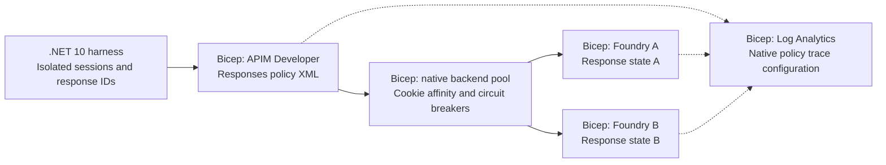
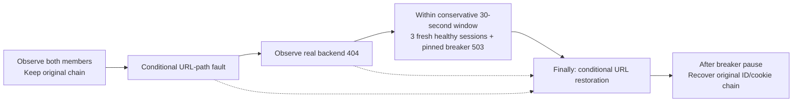

# 🧭 APIM Responses API affinity lab

**One conversation. One backend. Evidence for every turn.**

A hands-on lab under construction, exploring conversation-aware routing through Azure API
Management to two Microsoft Foundry backends. It will show why a
`previous_response_id` chain needs routing continuity, how independent requests
are distributed, and what happens when a conversation's backend becomes
unavailable.

> **Implemented lab components, not a live self-service lab.** Bootstrap is merged.
> Task `001` completed an explicitly authorized
> [disposable feasibility experiment](experiments/001-affinity/README.md):
> healthy affinity, native pinned failure, concrete-member identity, recovery,
> and workspace policy traces were verified. The temporary group is deleted.
> Task `002` adds the [Bicep infrastructure foundation](infra/README.md) with
> native `.bicepparam` inputs and resource diagnostics. Task `003` adds
> [gateway routing and policy diagnostics](infra/policies/README.md).
> Task `004` adds [guarded azd and Azure CLI lifecycle scripts](scripts/README.md).
> Task `005` adds the [bounded .NET 10 conversation harness](src/ResponsesLab/README.md).
> Task `006` adds [guarded fault and recovery automation](src/ResponsesLab/README.md#controlled-failure-and-recovery).
> Tasks `002`-`006` have local checks only; none has been run as the full live lab.
> End-to-end verification and the clean walkthrough remain tasks `007`-`008`.
> Task `007` live verification is now authorized and in progress on two new,
> dedicated environments; no full-lab deployment or live result is claimed yet.

## 🗺️ Architecture in code



*Implemented components, not a running deployment.* Bicep-labeled nodes,
gateway policies, lifecycle scripts, the client, and controlled-fault automation
have code; complete runtime verification remains planned.
Solid arrows show requests; dotted arrows show diagnostics. The harness keeps
routing context, Foundry owns response state, and APIM is not a
conversation-history database. Native pinning
during the tested breaker-open window was verified in the disposable experiment;
the complete self-service walkthrough is still pending.

## 🔎 What we know so far

| Area | Current finding |
| --- | --- |
| Region and gateway | West US 3, Developer SKU, one unit; disposable deployment verified and deleted |
| Model | **GPT-5.4 mini**, version `2026-03-17`, `GlobalStandard`; both temporary backends served Responses |
| Healthy-session routing | Four independent three-turn chains stayed pinned; eight stateless calls observed A=4/B=4 |
| Failure semantics | Existing A cookie received **503 / `CircuitBreakerIsOpen` without forwarding**, while three fresh sessions reached B; the original chain recovered on A |
| Backend proof | Outbound effective request host identified A/B and matched debug/workspace evidence; `context.Backend.Id` reported the pool, not the member |
| Tracing | All 54 captured responses joined to workspace rows with actual policy `TraceRecords`; full debugger transcripts remained separate |

Details, exact versions, sources, verification date, budgets, and limitations
are in the [platform evidence and design contract](docs/DESIGN.md). These
findings include live feasibility evidence, not completion of the full lab.
See the [sanitized run evidence](evidence/samples/task001-feasibility.json).
The 30-second breaker can expire while a fault persists; healthy-only new
routing is demonstrated within its open window, not promised indefinitely.

Both Foundry resources are planned for **West US 3**. The selected
`GlobalStandard` model deployment can process inference globally; resource
location does not imply West US 3-only processing.

## 🧪 Scenarios we intend to prove

| Scenario | Success means |
| --- | --- |
| Stateful conversations | Each independent response-ID chain stays on its original backend |
| Stateless distribution | Independent calls observe both backends; no promised perfect split |
| Controlled failure | The pinned conversation fails explicitly while fresh sessions reach a healthy backend |
| Recovery and evidence | The backend is restored, recovery is observed, and gateway/policy records correlate with the run |

The lab now has Bicep and APIM policy XML, `azd` orchestration, an equivalent
Azure CLI path, Log Analytics configuration, and the .NET 10 console harness.
Task `006` implements the opt-in fault workflow; complete scenario verification
remains planned.
The experiment has its own guarded probe, separate from the full-lab lifecycle
and .NET client.

## 🧱 Infrastructure and gateway configuration

[`infra/main.bicep`](infra/main.bicep) is resource-group-scoped: one Developer
gateway, two identical Foundry model deployments, scoped managed-identity
permissions, and Log Analytics. The gateway uses one dedicated **user-assigned
managed identity**, explicitly selected by the backend authentication policy;
no system-assigned fallback. It enables every inventoried parent log category
and `AllMetrics`, including workspace diagnostics. The group remains
externally owned; the template neither creates it nor selects a subscription.

Both lifecycle drivers use native [`deploy.bicepparam`](infra/deploy.bicepparam)
inputs; [`main.bicepparam`](infra/main.bicepparam) remains a placeholder-only
lower-level example. Local settings and compiler artifacts are ignored.
Exact AVM pins, parameter/output contracts,
diagnostic exclusions, and the local build/test commands are in the
[infrastructure reference](infra/README.md).

Task `003` adds a single HTTPS `POST /openai/v1/responses` operation, two
TLS-validated backends, the native affinity pool/breakers, API-scoped
subscription access, and managed-identity authentication. The
[gateway contract](infra/policies/README.md) explains first/chained/stateless
requests, lab-only headers, explicit errors, and trustworthy backend evidence.

The gateway returns `X-Lab-Request-Id` and a host-verified
`X-Lab-Backend-Id` after forwarding. Native policy traces are configured for
Log Analytics with zero body capture and no credential/cookie header capture.
The policy never retries a broken chain onto another backend.

**Not live yet:** local Bicep, XML, compiled-expression, and contract checks do
not establish Azure provisioning, full-lab routing, or diagnostic ingestion.
Those assertions remain in task `007`. No new Azure operations were performed
for tasks `002`-`006`; running the lifecycle scripts or inference still requires separate
target/action authorization.

## 🚦 Guarded deployment lifecycle

Task `004` implements two paths over the **same Bicep and native parameters**:
`Azd` uses `azd provision`; `Cli` uses Azure CLI only. Both check the active
subscription, exact model/quota/capacity, permissions, and group ownership,
create the dedicated group outside Bicep, and perform Provider validation and
what-if before deployment. Neither silently changes subscription or region.

| Action | Explicit opt-in / boundary |
| --- | --- |
| `Preflight` / `Export` | `-AllowAzure`, including read-only subscription checks |
| `Provision` | `-AllowAzure -AllowDeploy`; new or provably owned dedicated group only |
| `Run` | `-AllowAzure -AllowCredentialRead`, plus client `--allow-requests`; key in process environment only |
| Failure `Run` | Additionally `-AllowFaults -ConfirmResourceGroup <exact-name>` and the client's exact failure opt-ins; owned backend URL-only conditional updates |
| `Down` | `-AllowAzure -AllowDelete -ConfirmResourceGroup <exact-name>`; inventory-checked group deletion, no permanent purge |

Use **PowerShell 7**, Azure CLI 2.83.0+ with Bicep, and azd 1.36.0+ for the
`Azd` path. The [lifecycle guide](scripts/README.md) covers local publisher
configuration, both command paths, immutable environment records, non-secret
client handoff, reruns, failure handling, costs, and scoped teardown.
Use its wrapper rather than bare `azd` commands.

**Offline-tested, not a live walkthrough:** no Azure operations were performed
for tasks `004`-`006`. `Run` hands configuration/credentials to the published
.NET client. Clean-environment provisioning, real key handoff, reruns,
diagnostic ingestion, and deletion/recovery behavior remain task `007` gates.

## 💬 Conversation harness

Task `005` adds a .NET 10 console app with no model SDK or agent framework.
It interleaves independent multi-turn sessions, separately runs stateless
calls, and emits each turn's prompt/assistant text, response-chain IDs, actual
gateway request UUID, concrete member, safe cookie fingerprint, and outcome.
The final session table and separate distributions include failed and
unattempted work; a missing member is a failed observation, not a promised 50/50.

```powershell
# No Azure sign-in or inference: build, tests, and formatting checks.
dotnet build .\ResponsesLab.slnx --configuration Release
dotnet test .\ResponsesLab.slnx --configuration Release --no-restore
dotnet format .\ResponsesLab.slnx --verify-no-changes --no-restore
```

Defaults cap the script at 24 requests, 2,048 output tokens per request,
one request at a time, ten-second spacing, and a ten-minute overall deadline.
The client stops a broken chain; it never retries, restarts history, or accepts
a changed/missing member. The [harness guide](src/ResponsesLab/README.md)
documents publishing, the exact guarded run command, configuration bounds,
evidence fields, privacy, and exit codes. No live response sample or
workspace-ingestion claim is made by these offline checks.

## 🛠️ Controlled failure and recovery

Task `006` adds a separately authorized `failure` scenario. It first observes
both healthy backends, then changes **only one owned backend's URL path on its
existing Foundry host**. This is an endpoint-misconfiguration simulation, not a
physical service outage, model deletion, or synthetic policy error.



*Implemented workflow; live proof remains task `007`.* Every HTTP attempt has
phase/timing/correlation evidence. The gateway exposes a fixed
`CircuitBreakerIsOpen` reason only for that actual policy error, without
inventing an executed backend. A missed window or unrelated error fails.
Restoration gets its own bounded, uncancelled attempt; concurrent changes or
failed verification retain a non-secret recovery journal and fail visibly.

The [fault guide](src/ResponsesLab/README.md#controlled-failure-and-recovery)
documents exact opt-ins, ownership/ETag checks, budgets, recovery, hard-stop
limitations, and manual reconciliation. **No live faults were run for this
implementation.**

## 📚 Follow the work

| Document | Purpose |
| --- | --- |
| [Lab plan](docs/PLAN.md) | Agreed requirements and mandatory design gates |
| [Design and evidence](docs/DESIGN.md) | Verified findings, selected contracts, and resolved gates B1-B2 |
| [Infrastructure reference](infra/README.md) | Native parameters, pinned modules, diagnostics inventory, outputs, and offline checks |
| [Gateway contract](infra/policies/README.md) | Request modes, cookies, errors, identity, safe traces, and runtime verification gates |
| [Deployment lifecycle](scripts/README.md) | azd/CLI commands, prerequisites, explicit opt-ins, local state, credential handoff, and teardown |
| [Conversation harness](src/ResponsesLab/README.md) | .NET build/test/publish, healthy and guarded fault scenarios, timing/evidence, restoration, and failure accounting |
| [Task backlog](docs/TASKS.md) | Ordered work and acceptance criteria |
| [Progress tracker](docs/PROGRESS.md) | Authorization, execution history, and PR state |
| [Contributor instructions](.github/copilot-instructions.md) | Branch workflow, checks, and README standards |

## 🤝 Contributing safely

Use a focused work branch, not `main`. Keep the task and progress records
current, perform relevant checks, and open a PR when branch work is complete.
Leave PRs unmerged for the user. Start dependent work only from a merged
dependency or an explicitly documented dependency branch.

For documentation/bootstrap changes, run `git diff --check`, verify relative
links and relevant ignore behavior, and inspect the diff for scope and secrets.
Infrastructure build/test commands are in the
[infrastructure reference](infra/README.md); application commands are in the
[harness guide](src/ResponsesLab/README.md). Solution CI is not added by this task.
Text formatting is defined by `.editorconfig` and `.gitattributes`.

Never commit credentials or private environment settings. `.env.example` and
`.env.sample` files may contain placeholders only. Generated output belongs in
ignored `artifacts/` or `evidence/`; intentionally sanitized examples may be
versioned under `evidence/samples/`. Azure/azd local state is not versioned.

Completed task `001` had explicit authorization for the temporary billable
deployment, reversible fault, evidence, and cleanup in its dedicated group.
That exception did not authorize later tasks or operations against other resources.
The experiment used 59 of its 64-request allowance and deleted the dedicated
group within the three-hour bound. Both deleted Foundry accounts were purged
and model quota returned to baseline. Azure retains normal APIM/workspace
soft-delete recovery records; they are not a running gateway or workspace.
The under-$5 target was an estimate, not a billing cap; the final Azure bill
is not yet available. Tasks `002`-`006` have separate code-only authorization; later
deployments still require explicit authorization.
